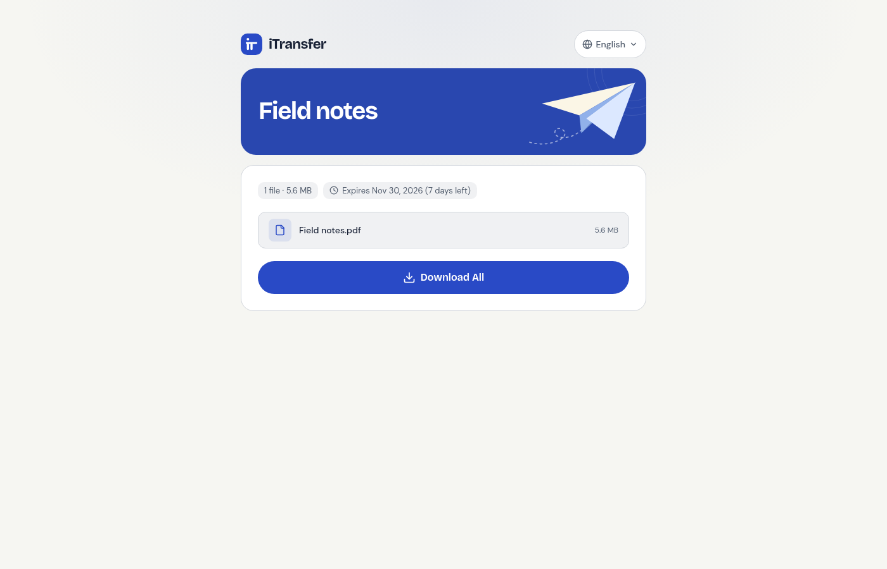
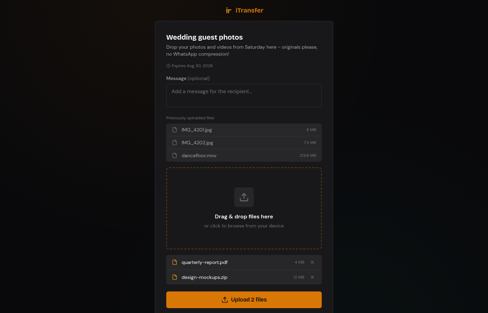
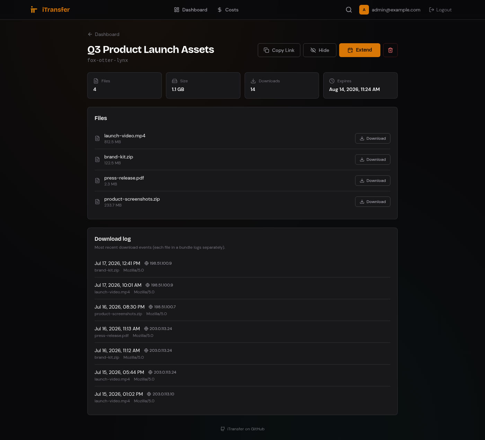

# iTransfer

**Last updated:** 2026-11-23

iTransfer is a self-hosted file-sharing service with an installable web app and a native Android app. Administrators invite people into private workspaces. Recipients can download files from a share link or upload them to a file request without creating an account.

The web app and API run on **Cloudflare Workers**. **D1** stores account and transfer metadata. Files move directly between the device and **R2** using short-lived presigned URLs, with multipart uploads for large files. Optional account and notification emails use a separately operated transactional mail service over HTTPS.

[Deploy your own instance](docs/INSTALLATION.md) · [Build an Android APK for your instance](android/README.md#build-locally)


<table>
  <tr>
    <td width="50%"></td>
    <td width="50%"></td>
  </tr>
  <tr>
    <td align="center"><em>Recipients download from a clean public page</em></td>
    <td align="center"><em>File requests let others send you files</em></td>
  </tr>
  <tr>
    <td width="50%"></td>
    <td width="50%"></td>
  </tr>
  <tr>
    <td align="center"><em>Expiry, download limits, passwords, link format</em></td>
    <td align="center"><em>Per-share stats and download log</em></td>
  </tr>
</table>

## Features

- **Web and Android apps** follow the device’s light or dark appearance. A folded paper plane marks outgoing shares and an envelope marks file requests. In supported browsers, sign in and choose **Install** on the dashboard.
- **Android 0.4.1** runs on Android 8.0 and later. At the top of **Shares** or **Requests**, pull down and release to refresh. To select several transfers, press and hold the first one, then tap the others. [Android guide](android/README.md#shares-and-requests)
- **Shares** - upload files, get a link. Optional title, password, expiry, max downloads.
- **File requests** - ask others to send you files, with optional password, size limit, upload limit and incremental mode.
- **Human-friendly URLs** - `your.domain/fox-cat-bear` (3-word animal combos) or random tokens.
- **Private workspaces** - invite-only accounts with `user` and `admin` roles. Users manage their own shares and requests; administrators can explicitly view or manage another workspace with audit attribution.
- **Account administration** - plain-text welcome mail explains iTransfer and includes a 24-hour setup link; mandatory reset mail includes a one-hour link. Neither can be opted out of. Manual links remain available if submission fails; there is no email-confirmation flow.
- **Optional email notifications** - default-off transfer notifications with bounded admission and deduplication. See [mail features and status](docs/USER-MANAGEMENT.md#transactional-email-and-preferences) for all five preference contracts.
- **Admin reporting** - account-wide and per-user gross R2 cost estimates, with one shared free tier applied only to the aggregate.
- **Programmatic API** - bearer-token `/api/v1/` endpoints for scripts and agents (see [docs/API.md](docs/API.md)).
- **Push notifications** - [ntfy](https://ntfy.sh)-compatible notifications on uploads and downloads.
- **Multi-language UI** - EN, NL, ES, CA, FR, IT, PT, PL, SV, DA.
- **Accessible password controls** - consistent eye/show-hide toggles on every password input, keyboard-operable with localized labels. New account passwords require 8–128 characters and pass browser-side common-password/pattern checks.
- **Auto-cleanup, nothing dangles** - hourly cron reclaims storage for abandoned uploads and expired shares/requests; an R2 lifecycle rule aborts incomplete multipart uploads.

## User management

Accounts are invite-only. Each person gets a private workspace; public transfer links remain a separate way for recipients to download or upload without an account.

| Capability | User | Administrator |
|---|---|---|
| Shares, requests and files | Own workspace only | Own workspace, plus explicit access to other workspaces |
| My Account | Change own password and optional email preferences | Same |
| Users | No access | Add accounts; edit name, email and role; disable/enable; reset passwords; force sign-out of all sessions |
| Cost reports | Hidden in both UI and API | Aggregate and per-user gross R2 estimates; one shared free tier on the aggregate |

**Invite and recover:** in **Users**, add a name, email and role. Mandatory welcome mail explains iTransfer and provides a **24-hour, single-use set-password link**. The recipient chooses a password, then signs in; there is **no separate email-verification step**. Administrators can issue a **one-hour reset link**, which revokes the target's sessions and replaces earlier setup links. Login sessions last **90 days by default**; changing a password signs out every session, including the current one.

**View as:** another user's workspace opens **read-only** (downloads are allowed). Changes require explicitly selecting **manage** mode and recent password confirmation. The administrator keeps their own identity: this is delegated access, not impersonation, and access attempts/outcomes are audited.

**Offboarding:** disabling an account blocks login and invalidates sessions/setup links, but **does not revoke public links or delete files**. Manage those separately. The last active administrator cannot be disabled or demoted, and there is no account-delete action.

### Email events and preferences

All messages are **plain text, never HTML**. Users configure optional messages in **My Account**; administrators can also change them in the user's **Users** settings, with recent password confirmation.

| Event / preference | When it is sent | Default |
|---|---|---|
| Welcome | Account creation; app introduction and 24-hour setup link | Always on |
| Password reset | Administrator-issued recovery; one-hour link | Always on |
| `share_downloads` | A download starts for an owned share; not proof of completion | Off |
| `request_uploads` | An upload to an owned request is finalized | Off |
| `password_changed` | Successful password change/reset, not initial setup | Off |
| `expiry_alerts` | Hourly checks warn about active resources expiring within 24 hours | Off |
| `invitation_reminders` | Administrator explicitly reminds an opted-in pending account | Off |

A pending-account reminder creates a **fresh 24-hour link and invalidates the previous link**; it is not an automatic resend. Optional mail is best-effort, deduplicated and quota-limited. “Always on” means welcome/reset cannot be opted out of, **not guaranteed delivery**. A `queued` response means accepted for processing. Failed, unknown or unconfigured submissions leave the account operation intact; use a still-valid returned link privately as a manual fallback. An unknown submission may already be queued—investigate rather than blindly resend. See [mail limits and recovery](docs/USER-MANAGEMENT.md#transactional-email-and-preferences).

## Architecture

```
Browser ── /api/* ──────────► Worker (Hono) ──► D1 (metadata)
   │                              │
   │                              ├─► signs presigned URLs (aws4fetch)
   │                              └─► HTTPS Mailer API ──► SMTP provider
   │                                  (separate service; no file bytes)
   └── PUT/GET file bytes ──────► R2 (direct, never through the Worker)
```

- Frontend (React 19 + Tailwind v4) is served as [Workers static assets](https://developers.cloudflare.com/workers/static-assets/) from the same Worker - one deployment, no CORS between UI and API.
- Shares and requests share the `/{id}` URL namespace; ID generation checks both tables.
- Account sessions use opaque cookies backed by hashed tokens in D1, with a **90-day default**. Old HMAC-signed cookies require a fresh login.
- The browser stretches account passwords with native WebCrypto PBKDF2-SHA256 at **600,000 iterations** into a 256-bit proof. The Worker uses native HKDF + peppered HMAC verification, with **no server-side password KDF for account authentication**. Share/request passwords retain their separate protocol and 3-attempts-per-15-minutes lockout.
- See [User management and operations](docs/USER-MANAGEMENT.md) for roles, bootstrap, recovery, deployment and security limits.
- Files larger than 100 MiB use multipart uploads to R2. The web app uploads up to four 50 MiB parts at a time.

## Deploy your own

**Start with the [first-time installation guide](docs/INSTALLATION.md).** It takes a fresh clone through a complete installation, including the new account and recovery flows. There is no all-in-one installer or `npm run setup`: the guide is the supported sequence, and `mail:configure` only configures the mail connection.

The guide covers, in order:

1. Install Node/dependencies and authenticate Wrangler to the intended Cloudflare account.
2. Create private configuration files and provision D1/R2. Configure the real D1 ID **before** applying all database migrations.
3. Set the HTTPS origin, R2 CORS, multipart cleanup, and bucket-scoped R2 credentials.
4. Prepare the first administrator, stable credential root, and optional automation/mail settings in an ignored secret file.
5. Deploy code and initial secrets together, using the private configuration and minification.
6. Sign in as the first administrator, add users, and test sharing, private workspaces, and password recovery.

Prerequisites are a Cloudflare account using **Workers Free**, enabled R2, and **Node 22.19+**. Browser authentication requires native WebCrypto in a secure context: HTTPS in production or localhost for development. The public configuration deliberately contains a placeholder D1 ID; keep actual instance values in ignored local configuration, not in this repository's tracked files.

Email is a separate choice: bring a compatible transactional Mailer API, or start with private manual setup/reset links. Installing iTransfer does **not** provision the mail service or grant access to somebody else's mail instance. SMTP credentials are never an iTransfer installation prerequisite.

**Workers Free reliability:** validate complete account flows on isolated hosted Free staging, measuring Worker CPU separately from browser derivation and wall time. Not every request is guaranteed to stay below 10 ms; occasional CPU bursts are not guaranteed capacity. See [historical release evidence and limits](docs/USER-MANAGEMENT.md#release-status-2026-09-08) and [Workers limits](https://developers.cloudflare.com/workers/platform/limits/).

**Existing installation?** Use the [upgrade and rollback checklist](docs/USER-MANAGEMENT.md#deployment-and-rollback), not the fresh-install secret initialization steps. Back up first, retain the credential root, apply new migrations before the new binary, and do not overwrite production secrets with old local values. See the [installation troubleshooting table](docs/INSTALLATION.md#troubleshooting-and-maintenance) for failed first installs.

### Credentials and bootstrap

`ADMIN_EMAIL` and `ADMIN_PASSWORD` bootstrap the first administrator only when there are no users and no durable bootstrap marker. Bootstrap assigns ownerless shares/requests to that administrator. For migration compatibility, the exact configured password is accepted even if it fails the new policy, but **a password change is then required before workspace/admin access**. Environment credentials remain startup requirements, **never a reset or login fallback after bootstrap**. See [bootstrap and first-login repair](docs/USER-MANAGEMENT.md#bootstrap) for the protocol and recovery constraints.

**Protect `SESSION_SECRET`:** generate at least 32 random bytes, represented as 64 hex characters. Runtime checks only a minimum length of 32 characters, not entropy. It is the credential root for HKDF-derived HMAC peppering and rate-limit pseudonyms, **not a login-cookie signing key**. Rotation invalidates stored account verifiers and requires controlled account resets; do not casually rotate it to revoke sessions. See [credential-root recovery](docs/USER-MANAGEMENT.md#credential-root-and-rotation).

**Automation token:** `API_BEARER_TOKEN` is an optional global file-management credential, not a per-user key. It can access all workspaces through `/api/v1/`, including downloads and deletion, but cannot administer user accounts. Account disablement and session/password changes do not revoke it. Keep it in trusted server-side tools or leave it unset; see [API credential boundaries](docs/API.md).

The first-party browser enforces new-password length/common-password rejection. The Worker validates only fixed-format 256-bit proofs on normal account endpoints and cannot attest password quality or that a malicious client performed PBKDF2. Proofs are **replayable password equivalents**: use TLS and never log them or put them in URLs, local/session storage or caches. D1 stores peppered HMAC verifiers, not proofs; protection against offline guessing from a D1-only leak depends on keeping the credential root separate.

> **Notification privacy:** ntfy upload/download push messages include the recipient's IP address, country and user agent; transactional emails **do not include these visitor details**. If you set `NTFY_URL`, use a private topic (long random name) or a self-hosted server—anyone who guesses a public ntfy.sh topic can read its messages. Download events are also kept in the per-share dashboard log and pruned with share history after `HISTORY_RETENTION_DAYS`.

## Connect transactional mail

**No SMTP connection or credentials in iTransfer.** The Worker calls the mailer's HTTPS API using an **app-scoped bearer key**. SMTP usernames, passwords and connection settings belong only to the separately operated mail service; never publish them or copy them into iTransfer. The mailer receives recipient/message metadata and plain-text content, including setup links when applicable—not uploaded files.

The integration uses `POST /v1/emails`, `Authorization: Bearer <app-key>` and a stable `Idempotency-Key` header with JSON `{to, subject, text, expires_at}`. Grant the service app **raw-mail permission** and review its allowed-recipient restrictions. Catalog access alone does not establish send permission. iTransfer sends **no `html` field or template IDs**: the canonical templates currently also generate HTML without a plain-text-only switch, so message copy is authored locally.

Create a protected, gitignored `transactional.key` file containing these two assignments (replace the placeholder privately):

```dotenv
TRANSACTIONAL_MAIL_API_URL=https://mailer.example.com
TRANSACTIONAL_MAIL_API_KEY=<your-app-scoped-key>
```

The URL must be an HTTPS **origin only**, without an endpoint path. Keep both settings server-side, using Worker secrets or protected local configuration—never browser bundles, `VITE_*` variables, public Wrangler `vars`, or committed examples containing real values. Do not pass raw keys as command-line arguments.

```bash
npm run mail:configure
# Production only: explicitly update remote secrets using your private config
npm run mail:configure -- --remote --config wrangler.local.jsonc
```

The default command updates **only local `.dev.vars`**, preserving unrelated secrets and setting mode **0600**. Remote mode updates Worker secrets; it **does not deploy**, send a test email, or prove delivery. Do not use it as a connectivity test. An authenticated `GET /v1/templates` can check key/catalog access without sending mail, but proves neither raw-mail permission nor inbox delivery.

For a fresh install, run the local helper **before the first deployment with initial secrets**, as described in the [installation guide](docs/INSTALLATION.md). For an already deployed Worker, use the explicit remote command to enable or rotate the connection. This adapter targets the documented Mailer API and its app-key format; an SMTP password, or an arbitrary Resend/SendGrid token, is not a compatible substitute.

Mail keys normally rotate every **90 days**, with overlap coordinated with the mail service's queue. They are unrelated to **`SESSION_SECRET`—never rotate the account credential root as part of mail-key maintenance**. See [configuration, rotation and submission recovery](docs/USER-MANAGEMENT.md#mail-configuration-and-key-rotation).

## Local development

Use a reviewed `wrangler.local.jsonc` as described in the [installation guide](docs/INSTALLATION.md). If `.dev.vars` already exists, **preserve it** and review it privately; do not copy the example over existing credentials. Only when creating the file for the first time:

```bash
test ! -e .dev.vars && test ! -L .dev.vars && install -m 600 .dev.vars.example .dev.vars
```

Fill the new file privately, then start the Worker:

```bash
npm run build:frontend
npm run db:migrate:local -- -c wrangler.local.jsonc
npm run dev -- -c wrangler.local.jsonc     # Worker on :8787
```

In a second terminal at the repository root:

```bash
npm --prefix frontend run dev              # Vite on :5173, proxies /api to :8787
```

Note: presigned URLs always point at real R2, so uploads/downloads require valid `R2_*` credentials even in local dev. Account and share/request metadata use local D1, but configured mail and ntfy integrations still make external requests. Use isolated test services or leave them unconfigured to avoid real notifications.

### Tests

```bash
npm test                 # isolated backend regression tests
npm run test:ui          # separate Playwright browser suite
```

Install root and frontend dependencies first. For the UI suite, install Chromium with `npx playwright install chromium` and provide its platform libraries (on supported Linux distributions, `npx playwright install-deps chromium`). On NixOS, use a Nix-provided Chromium with its runtime dependencies and set `PLAYWRIGHT_CHROMIUM_EXECUTABLE_PATH=/path/to/chromium` when running `npm run test:ui`. The harness starts Vite unless `UI_BASE_URL` points to an existing test server. These tests do not establish hosted CPU performance. See [backend test details](tests/README.md).

## Cost

Cloudflare provides free internet egress for files downloaded directly from R2. [R2 pricing](https://developers.cloudflare.com/r2/pricing/)

The cost page is administrator-only and estimates **R2 only**, not the full Cloudflare bill. Workers Free is the required baseline; a paid plan is optional, not necessary by design. The Free plan's **100,000 Worker requests/day** and D1 daily read/write and storage quotas still apply. Quota exhaustion can interrupt service; client-side stretching does not remove request/database usage. The estimate excludes Workers/D1 operation fees, optional paid-plan charges and quota-exhaustion effects, so it is not a guarantee of zero total cost or availability.

Per-user figures are **gross**. The aggregate applies one shared R2 free tier (10 GB-month storage, 1M Class A operations and 10M Class B operations), assuming it is entirely available to this instance; it is not granted separately to each user. Storage is a current confirmed-file snapshot under active parents, not historical GB-days. Operations are 30-day application estimates, not measured R2 billing. Purged historical usage, retries and other untracked operations can make estimates incomplete. See [cost limitations](docs/API.md#cost).

## Rate limiting

Password brute-forcing is locked out at the application level (3 failed attempts per 15 minutes per share/request). For broader rate limits on public endpoints, add a [WAF rate limiting rule](https://developers.cloudflare.com/waf/rate-limiting-rules/) on `/api/public/*` in the Cloudflare dashboard - it's a better fit than in-Worker limiting.

Account login has independent email quotas of **8/15 minutes and 20/hour**, and IP quotas of **30/15 minutes and 100/hour**. Challenges have a separate policy: **120/15 minutes and 400/hour per IP**, **60/15 minutes and 200/hour per identity**. Reauthentication has separate session and user namespaces, recovery has a separate token namespace, and admin writes have a higher budget. Successful requests do not reset admission counters. See [the full policy](docs/USER-MANAGEMENT.md#authentication-and-rate-limits).

## License

[MIT](LICENSE)
