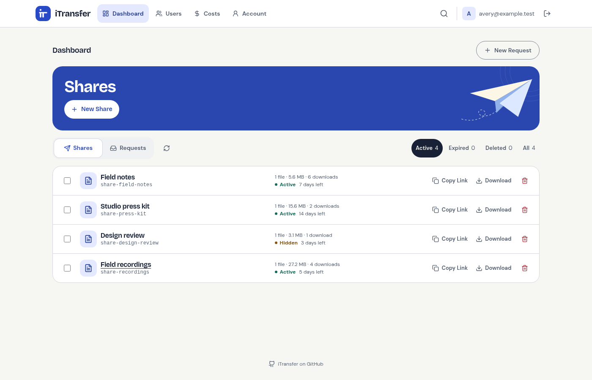

# iTransfer

**Last updated:** 2026-09-08

Self-hosted WeTransfer-style file sharing, built entirely on Cloudflare: **Workers** (API + static frontend), **R2** (file storage) and **D1** (metadata). One `wrangler deploy` gives you share links, file requests, password protection, expiry, download limits and push notifications - with zero servers to maintain.

File bytes never pass through the Worker: the API hands out short-lived presigned R2 URLs and browsers upload/download directly to/from R2. There is **no practical file size limit** from Workers (R2 allows objects up to ~5 TiB), egress is free, and large files use multipart uploads (50 MB parts, 4 concurrent).



<table>
  <tr>
    <td width="50%"></td>
    <td width="50%"></td>
  </tr>
  <tr>
    <td align="center"><em>Recipients download from a clean public page</em></td>
    <td align="center"><em>File requests let others send you files</em></td>
  </tr>
  <tr>
    <td width="50%"></td>
    <td width="50%"></td>
  </tr>
  <tr>
    <td align="center"><em>Expiry, download limits, passwords, link format</em></td>
    <td align="center"><em>Per-share stats and download log</em></td>
  </tr>
</table>

## Features

- **Shares** - upload files, get a link. Optional title, password, expiry, max downloads.
- **File requests** - ask others to send you files, with optional password, size limit, upload limit and incremental mode.
- **Human-friendly URLs** - `your.domain/fox-cat-bear` (3-word animal combos) or random tokens.
- **Private workspaces** - invite-only accounts with `user` and `admin` roles. Users manage their own shares and requests; administrators can explicitly view or manage another workspace with audit attribution.
- **Account administration** - plain-text welcome mail explains iTransfer and includes a 24-hour setup link; mandatory reset mail includes a one-hour link. Neither can be opted out of. Manual links remain available if submission fails; there is no email-confirmation flow.
- **Optional email notifications** - default-off transfer notifications with bounded admission and deduplication. See [mail features and status](docs/USER-MANAGEMENT.md#transactional-email-and-preferences) for all five preference contracts.
- **Admin reporting** - account-wide and per-user gross R2 cost estimates, with one shared free tier applied only to the aggregate.
- **Programmatic API** - bearer-token `/api/v1/` endpoints for scripts and agents (see [docs/API.md](docs/API.md)).
- **Push notifications** - [ntfy](https://ntfy.sh)-compatible notifications on uploads and downloads.
- **Multi-language UI** - EN, NL, ES, CA, FR, IT, PT, PL, SV, DA.
- **Auto-cleanup, nothing dangles** - hourly cron reclaims storage for abandoned uploads and expired shares/requests; an R2 lifecycle rule aborts incomplete multipart uploads.

## Architecture

```
Browser ── /api/* ──────────► Worker (Hono) ──► D1 (metadata)
   │                              │
   │                              └─► signs presigned URLs (aws4fetch)
   └── PUT/GET file bytes ──────► R2 (direct, never through the Worker)
```

- Frontend (React 19 + Tailwind v4) is served as [Workers static assets](https://developers.cloudflare.com/workers/static-assets/) from the same Worker - one deployment, no CORS between UI and API.
- Shares and requests share the `/{id}` URL namespace; ID generation checks both tables.
- Account sessions use opaque cookies backed by hashed tokens in D1, with a **90-day default**. Old HMAC-signed cookies require a fresh login.
- The browser stretches account passwords with native WebCrypto PBKDF2-SHA256 at **600,000 iterations** into a 256-bit proof. The Worker uses native HKDF + peppered HMAC verification, with **no server-side password KDF for account authentication**. Share/request passwords retain their separate protocol and 3-attempts-per-15-minutes lockout.
- See [User management and operations](docs/USER-MANAGEMENT.md) for roles, bootstrap, recovery, deployment and security limits.
- Files >100 MB automatically use S3-style multipart uploads against R2.

## Deploy your own

Prerequisites: a Cloudflare account using **Workers Free**, **Node 22.19+**, and `npx wrangler login`. Browser account authentication requires native WebCrypto in a secure context: HTTPS in production or localhost for development. Configure transactional mail for account emails; without it, account operations still provide manual links.

**Workers Free reliability:** validate complete account flows on isolated hosted Free staging, measuring Worker CPU separately from browser derivation and wall time. The deployed release's isolated checks had no runtime failures, but **four requests exceeded 10 ms** (including cold execution): this is not a strict 10 ms validation pass. Free permits occasional CPU bursts, not guaranteed capacity for every request. No plan upgrade was made. See [release evidence and limits](docs/USER-MANAGEMENT.md#release-status-2026-09-08).

For an existing installation, follow the [migration and rollout checklist](docs/USER-MANAGEMENT.md#deployment-and-rollback) first: back up, apply schema migrations before the new binary, and bootstrap deliberately.

### 1. Create the resources

```bash
npx wrangler d1 create itransfer          # paste the printed id into wrangler.jsonc
npx wrangler r2 bucket create itransfer-files
npx wrangler d1 migrations apply itransfer --remote
```

### 2. Configure R2 CORS + API token

Browsers talk to R2 directly, so the bucket needs CORS (edit `r2-cors.json` to your domain first):

```bash
npx wrangler r2 bucket cors set itransfer-files --file r2-cors.json
```

Also set the lifecycle policy that aborts abandoned multipart uploads after 7 days (otherwise incomplete parts accumulate invisibly and are billed):

```bash
npx wrangler r2 bucket lifecycle set itransfer-files --file r2-lifecycle.json
```

Create an R2 API token in the dashboard (**R2 → Manage R2 API Tokens → Create API Token**, permission *Object Read & Write*, scoped to the bucket). You'll get an Access Key ID and Secret Access Key used in step 3.

### 3. Set secrets

```bash
openssl rand -hex 32 | npx wrangler secret put SESSION_SECRET
npx wrangler secret put ADMIN_EMAIL
npx wrangler secret put ADMIN_PASSWORD
npx wrangler secret put API_BEARER_TOKEN      # openssl rand -hex 32
npx wrangler secret put NTFY_URL              # optional, e.g. https://ntfy.sh/your-topic
npx wrangler secret put R2_ACCESS_KEY_ID
npx wrangler secret put R2_SECRET_ACCESS_KEY
npx wrangler secret put R2_ACCOUNT_ID         # dashboard → Workers & Pages → right sidebar
```

No secret ever lives in the repo - `wrangler.jsonc` only contains non-sensitive vars.

`ADMIN_EMAIL` and `ADMIN_PASSWORD` bootstrap the first administrator only when `users` is empty and the durable marker is absent. Only this one-time flow sends `bootstrap_password` alongside the client proof. For migration compatibility, the **exact existing configured password is accepted even if it fails the new password policy**: the account then returns `password_change_required: true`, blocking workspaces, administration and session-based costs until a successful own-password change or reset. A policy-compliant bootstrap password sets the flag to `false`. Bootstrap atomically assigns ownerless shares/requests. Environment values remain startup requirements but are **never a reset or login fallback after bootstrap**. New passwords still use the browser's 8–128-character/common-password policy and 600,000-iteration derivation.

**Protect `SESSION_SECRET`:** generate at least 32 random bytes (the command above produces 64 hex characters). Runtime checks only a minimum length of 32 characters, not entropy. It is the credential root for HKDF-derived HMAC peppering and rate-limit pseudonyms, **not a login-cookie signing key**. Rotation invalidates stored account verifiers and requires controlled account resets; do not casually rotate it to revoke sessions. See [credential-root recovery](docs/USER-MANAGEMENT.md#credential-root-and-rotation).

The first-party browser enforces new-password length/common-password rejection. The Worker validates only fixed-format 256-bit proofs on normal account endpoints and cannot attest password quality or that a malicious client performed PBKDF2. Proofs are **replayable password equivalents**: use TLS and never log them or put them in URLs, local/session storage or caches. D1 stores peppered HMAC verifiers, not proofs; protection against offline guessing from a D1-only leak depends on keeping the credential root separate.

> **Privacy note on notifications:** upload/download notifications include the recipient's IP address, country, and user agent. If you set `NTFY_URL`, use a private topic (long random name) or a self-hosted ntfy server - on a public ntfy.sh topic anyone who guesses the name can read those details. Download events are also kept in the dashboard's per-share log and pruned with share history after `HISTORY_RETENTION_DAYS`.

### 4. Set your domain and deploy

Edit `wrangler.jsonc`: paste your D1 `database_id` and set `vars.PUBLIC_ORIGIN` to your hostname. By default the Worker deploys to `itransfer.<your-subdomain>.workers.dev`; for a custom domain set `"workers_dev": false` and add a `routes` entry (example in the file). Then:

```bash
npm install && cd frontend && npm install && cd ..
npm run deploy
```

Prefer to keep your instance config out of git? Copy `wrangler.jsonc` to `wrangler.local.jsonc` (gitignored), put your real values there, and pass it through npm: `npm run deploy -- -c wrangler.local.jsonc` (works for `dev` and `db:migrate:*` too). Same idea for CORS: `r2-cors.local.json`.

After deployment, the operator must make the first sign-in using the existing configured credentials. If prompted to change the password, enter the old password as the current password and choose a new policy-compliant password; then sign in again. No initial bootstrap reset email is sent. Verify legacy ownership and create a second administrator after the restriction is cleared. Welcome setup links expire after 24 hours; reset links after one hour. Queued mail means accepted, **not delivered**; mail failure does not roll back account creation. Use manual links privately when appropriate, without blindly resending uncertain submissions.

### 5. Configure transactional mail

Use `TRANSACTIONAL_MAIL_API_URL=https://mailer.example.com` (HTTPS **origin only**, no endpoint path) and `TRANSACTIONAL_MAIL_API_KEY` as Worker-side secrets. The service app must allow raw mail: iTransfer sends `{to,subject,text,expires_at}`, **never HTML**. Local plain-text copy implements canonical event semantics without invoking provider template IDs, since all canonical templates generate HTML and have no format flag.

Put the two env-style assignments in a gitignored private `transactional.key` file. `npm run mail:configure` runs `scripts/configure-mail.mjs` and defaults to updating local `.dev.vars` with mode `0600`, preserving unrelated secrets. See [configuration and rotation](docs/USER-MANAGEMENT.md#mail-configuration-and-key-rotation).

`--remote` explicitly updates Worker secrets via secret bulk; it is **not deployment** and must not be used as a connectivity test. Local configuration and authenticated `GET /v1/templates` can verify key/catalog access without sending real mail; neither proves delivery. Mail keys normally rotate every 90 days with overlap. They are unrelated to the credential-root `SESSION_SECRET`: never change that root during mail-key rotation.

**Production release, 2026-09-08:** authorized maintenance cutover and minified application deployment completed on both configured origins, with Workers Free unchanged. Migrations **0004–0007 are deployed and immutable**; existing record counts were preserved after backup/restore-integrity checks. Existing secrets, including the credential root, were retained; the two mail settings were installed remotely. Local validation passed **97 backend tests, 51 browser scenarios, typecheck and build**; lint had zero errors and one existing Fast Refresh warning. Live health/readiness and authorization probes passed. First administrator sign-in remained outstanding at the release check; no production credentials were retrieved and no real email was sent. [Detailed CPU observations](docs/USER-MANAGEMENT.md#release-status-2026-09-08) are limited evidence, not a workload guarantee.

## Local development

```bash
cp .dev.vars.example .dev.vars     # fill in values
npm run db:migrate:local
npm run dev                        # Worker on :8787
cd frontend && npm run dev         # Vite on :5173, proxies /api → :8787
```

Note: presigned URLs always point at real R2, so uploads/downloads require valid `R2_*` credentials even in local dev. Everything else (auth, shares/requests CRUD) works fully offline against the local D1.

### Tests

```bash
npm test                 # isolated backend regression tests
npm run test:ui          # separate Playwright browser suite
```

Install root and frontend dependencies first. For the UI suite, install Chromium with `npx playwright install chromium` and provide its platform libraries (on supported Linux distributions, `npx playwright install-deps chromium`). On NixOS, use a Nix-provided Chromium with its runtime dependencies and set `PLAYWRIGHT_CHROMIUM_EXECUTABLE_PATH=/path/to/chromium` when running `npm run test:ui`. The harness starts Vite unless `UI_BASE_URL` points to an existing test server. These tests do not establish hosted CPU performance. See [backend test details](tests/README.md).

## Cost

The cost page is administrator-only and estimates **R2 only**, not the full Cloudflare bill. Workers Free is the required baseline; a paid plan is optional, not necessary by design. The Free plan's **100,000 Worker requests/day** and D1 daily read/write and storage quotas still apply. Quota exhaustion can interrupt service; client-side stretching does not remove request/database usage. The estimate excludes Workers/D1 operation fees, optional paid-plan charges and quota-exhaustion effects, so it is not a guarantee of zero total cost or availability.

Per-user figures are **gross**. The aggregate applies one shared R2 free tier (10 GB-month storage, 1M Class A operations and 10M Class B operations), assuming it is entirely available to this instance; it is not granted separately to each user. Storage is a current confirmed-file snapshot under active parents, not historical GB-days. Operations are 30-day application estimates, not measured R2 billing. Purged historical usage, retries and other untracked operations can make estimates incomplete. See [cost limitations](docs/API.md#cost).

## Rate limiting

Password brute-forcing is locked out at the application level (3 failed attempts per 15 minutes per share/request). For broader rate limits on public endpoints, add a [WAF rate limiting rule](https://developers.cloudflare.com/waf/rate-limiting-rules/) on `/api/public/*` in the Cloudflare dashboard - it's a better fit than in-Worker limiting.

Account login has independent email quotas of **8/15 minutes and 20/hour**, and IP quotas of **30/15 minutes and 100/hour**. Challenges have a separate policy: **120/15 minutes and 400/hour per IP**, **60/15 minutes and 200/hour per identity**. Reauthentication has separate session and user namespaces, recovery has a separate token namespace, and admin writes have a higher budget. Successful requests do not reset admission counters. See [the full policy](docs/USER-MANAGEMENT.md#authentication-and-rate-limits).

## License

[MIT](LICENSE)
