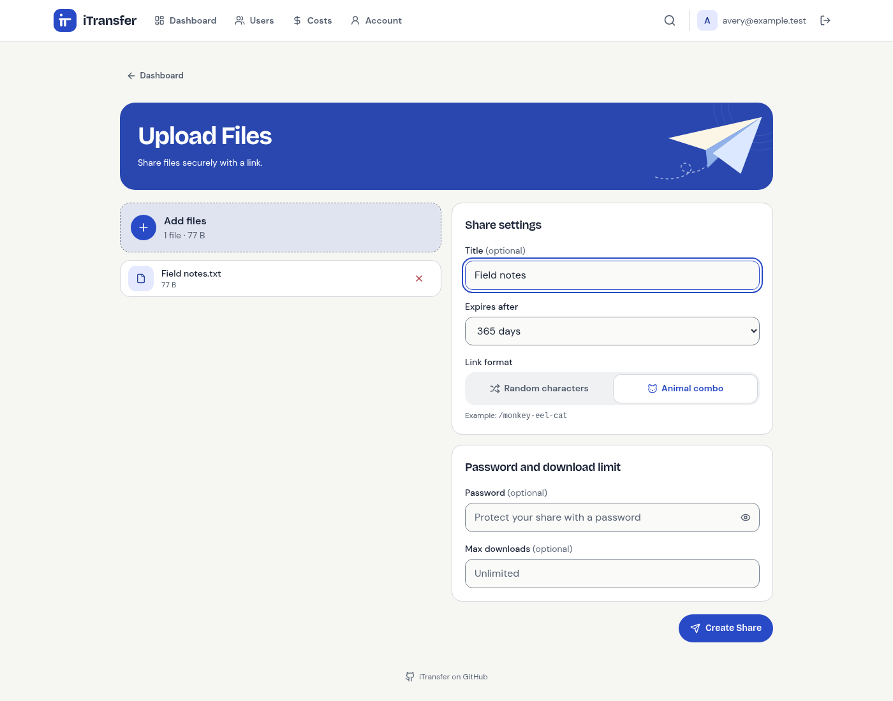

# iTransfer

Self-hosted WeTransfer-style file sharing, built entirely on Cloudflare: **Workers** (API + static frontend), **R2** (file storage) and **D1** (metadata). One `wrangler deploy` gives you share links, file requests, password protection, expiry, download limits and push notifications - with zero servers to maintain.

File bytes never pass through the Worker: the API hands out short-lived presigned R2 URLs and browsers upload/download directly to/from R2. There is **no practical file size limit** from Workers (R2 allows objects up to ~5 TiB), egress is free, and large files use multipart uploads (50 MB parts, 4 concurrent).


<table>
  <tr>
    <td width="50%"></td>
    <td width="50%"></td>
  </tr>
  <tr>
    <td align="center"><em>Recipients download from a clean public page</em></td>
    <td align="center"><em>File requests let others send you files</em></td>
  </tr>
  <tr>
    <td width="50%"></td>
    <td width="50%"></td>
  </tr>
  <tr>
    <td align="center"><em>Expiry, download limits, passwords, link format</em></td>
    <td align="center"><em>Per-share stats and download log</em></td>
  </tr>
</table>

## Features

- **Shares** - upload files, get a link. Optional title, password, expiry, max downloads.
- **File requests** - ask others to send you files, with optional password, size limit, upload limit and incremental mode.
- **Human-friendly URLs** - `your.domain/fox-cat-bear` (3-word animal combos) or random tokens.
- **Admin dashboard** - React SPA with share/request management, download stats and an R2 cost estimate.
- **Programmatic API** - bearer-token `/api/v1/` endpoints for scripts and agents (see [docs/API.md](docs/API.md)).
- **Push notifications** - [ntfy](https://ntfy.sh)-compatible notifications on uploads and downloads.
- **Multi-language UI** - EN, NL, ES, CA, FR, IT, PT, PL, SV, DA.
- **Auto-cleanup, nothing dangles** - hourly cron reclaims storage for abandoned uploads and expired shares/requests; an R2 lifecycle rule aborts incomplete multipart uploads.

## Architecture

```
Browser ── /api/* ──────────► Worker (Hono) ──► D1 (metadata)
   │                              │
   │                              └─► signs presigned URLs (aws4fetch)
   └── PUT/GET file bytes ──────► R2 (direct, never through the Worker)
```

- Frontend (React 19 + Tailwind v4) is served as [Workers static assets](https://developers.cloudflare.com/workers/static-assets/) from the same Worker - one deployment, no CORS between UI and API.
- Shares and requests share the `/{id}` URL namespace; ID generation checks both tables.
- Sessions are HMAC-signed cookies; share/request passwords are PBKDF2-SHA256 hashes with a 3-attempts-per-15-minutes lockout.
- Files >100 MB automatically use S3-style multipart uploads against R2.

## Deploy your own

Prerequisites: a Cloudflare account, Node 20+, and `npx wrangler login`.

### 1. Create the resources

```bash
npx wrangler d1 create itransfer          # paste the printed id into wrangler.jsonc
npx wrangler r2 bucket create itransfer-files
npx wrangler d1 migrations apply itransfer --remote
```

### 2. Configure R2 CORS + API token

Browsers talk to R2 directly, so the bucket needs CORS (edit `r2-cors.json` to your domain first):

```bash
npx wrangler r2 bucket cors set itransfer-files --file r2-cors.json
```

Also set the lifecycle policy that aborts abandoned multipart uploads after 7 days (otherwise incomplete parts accumulate invisibly and are billed):

```bash
npx wrangler r2 bucket lifecycle set itransfer-files --file r2-lifecycle.json
```

Create an R2 API token in the dashboard (**R2 → Manage R2 API Tokens → Create API Token**, permission *Object Read & Write*, scoped to the bucket). You'll get an Access Key ID and Secret Access Key used in step 3.

### 3. Set secrets

```bash
openssl rand -hex 32 | npx wrangler secret put SESSION_SECRET
npx wrangler secret put ADMIN_EMAIL
npx wrangler secret put ADMIN_PASSWORD
npx wrangler secret put API_BEARER_TOKEN      # openssl rand -hex 32
npx wrangler secret put NTFY_URL              # optional, e.g. https://ntfy.sh/your-topic
npx wrangler secret put R2_ACCESS_KEY_ID
npx wrangler secret put R2_SECRET_ACCESS_KEY
npx wrangler secret put R2_ACCOUNT_ID         # dashboard → Workers & Pages → right sidebar
```

No secret ever lives in the repo - `wrangler.jsonc` only contains non-sensitive vars.

> **Privacy note on notifications:** upload/download notifications include the recipient's IP address, country, and user agent. If you set `NTFY_URL`, use a private topic (long random name) or a self-hosted ntfy server - on a public ntfy.sh topic anyone who guesses the name can read those details. Download events are also kept in the dashboard's per-share log and pruned with share history after `HISTORY_RETENTION_DAYS`.

### 4. Set your domain and deploy

Edit `wrangler.jsonc`: paste your D1 `database_id` and set `vars.PUBLIC_ORIGIN` to your hostname. By default the Worker deploys to `itransfer.<your-subdomain>.workers.dev`; for a custom domain set `"workers_dev": false` and add a `routes` entry (example in the file). Then:

```bash
npm install && cd frontend && npm install && cd ..
npm run deploy
```

Prefer to keep your instance config out of git? Copy `wrangler.jsonc` to `wrangler.local.jsonc` (gitignored), put your real values there, and pass it through npm: `npm run deploy -- -c wrangler.local.jsonc` (works for `dev` and `db:migrate:*` too). Same idea for CORS: `r2-cors.local.json`.

## Local development

```bash
cp .dev.vars.example .dev.vars     # fill in values
npm run db:migrate:local
npm run dev                        # Worker on :8787
cd frontend && npm run dev         # Vite on :5173, proxies /api → :8787
```

Note: presigned URLs always point at real R2, so uploads/downloads require valid `R2_*` credentials even in local dev. Everything else (auth, shares/requests CRUD) works fully offline against the local D1.

## Cost

With R2's free tier (10 GB-month storage, 1M writes, 10M reads per month, free egress) and the Workers free plan, a personal instance typically costs **$0/month**. The dashboard's cost page shows a worst-case estimate ignoring the free tier.

## Rate limiting

Password brute-forcing is locked out at the application level (3 failed attempts per 15 minutes per share/request). For broader rate limits on public endpoints, add a [WAF rate limiting rule](https://developers.cloudflare.com/waf/rate-limiting-rules/) on `/api/public/*` in the Cloudflare dashboard - it's a better fit than in-Worker limiting.

## License

[MIT](LICENSE)
